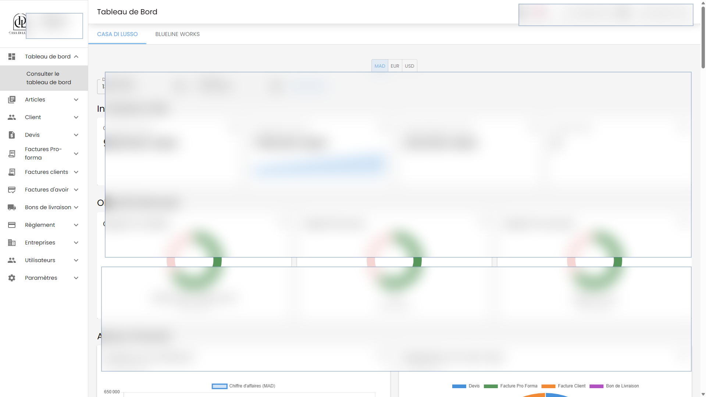
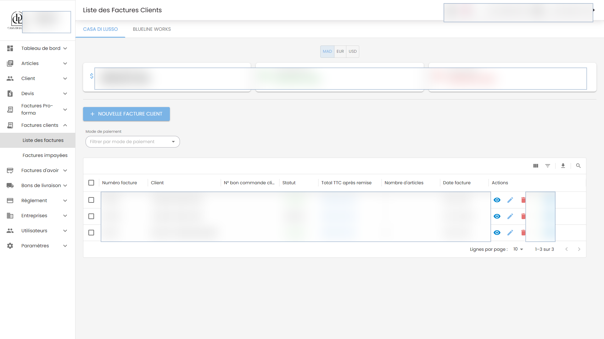

# Facturation Backend

Django REST API for a billing operations platform for quotes, pro-forma invoices, customer invoices, credit notes, delivery notes, payments, clients, articles, company settings, dashboards, notifications, and printable business documents.

This is a production-oriented business backend. It models real operational workflows, authenticated staff access, API filtering, document/report generation, realtime notification plumbing, and testable domain behavior.

## Background PDF translations

With `AI_PDF_TRANSLATION_ENABLED=true`, saving PDF content prepares durable French,
English, and Dutch translations without calling the model in the web request.
PDF generation reads those saved values. An exact text or protected-name change
creates a new translation snapshot; original business data is preserved.

The historical scan runs on the normal Celery queue, separately from the dedicated
translation worker, so scanning existing records keeps progressing during inference.

The worker first requests a translation through the signed AI gateway. It uses
the local CTranslate2 OPUS/Argos models when Groq is rate-limited or the gateway
is slow or unavailable. The offline path uses Lingua for language detection
and routes French to and from Dutch through English. Model files come from
`PDF_TRANSLATION_MODELS_DIR`. Names, references, numeric values, and layout
are checked before a translation is saved.

Install models once before starting the worker:

```bash
python manage.py prepare_pdf_translation_models
python manage.py prepare_pdf_translation_models --check
```

Downloads have pinned SHA-256 checksums. Runtime weights stay outside Git and
Docker images; Compose mounts `./translation-models` read-only at `/models`.
The original model attribution and CC-BY 4.0 notices are retained in each model
package's README. Local model installation can use `--archives /path/to/archives`.

The `pdf-translations` Compose worker consumes the `pdf_translations` queue with
one process, independently of notification and stock jobs. Run it locally with
`celery -A facturation_backend worker -Q pdf_translations --concurrency=1`.
Celery Beat recovers pending or expired work every minute. Requests for a newly
edited PDF have priority over the historical backfill.

After migrations and worker startup, queue existing content with:

```bash
python manage.py translate_pdf_content
python manage.py translate_pdf_content --status
```

The backfill is bounded and safe to repeat. Optional `--company ID`, repeated
`--language fr|en|nl`, and `--batch-size 100` restrict a run. After resolving a
translation service failure, `--retry-failed` retries terminal failures. No
customer text is included in task messages or error logs.

## What It Shows

- Backend ownership for a complete internal business application.
- Django REST API design across related business modules.
- PostgreSQL data modeling for operational records and audit/history needs.
- Auth, permissions, SSO subject handling, filters, dashboards, exports, and realtime events.
- Testable backend code with pytest tooling instead of only manual checks.

## Main Modules

- account
- article
- client
- company
- devi
- facture_client
- facture_proforma
- facture_avoir
- bon_de_livraison
- reglement
- dashboard
- notification
- ws

## Key Capabilities

- Django REST API for quote, invoice, credit note, delivery note, payment, client, article, and company workflows.
- Multi-company user access with JWT/session auth, SSO subject support, permission-aware endpoints, and django-axes protection.
- Dashboard totals, settlement tracking, unpaid invoice views, due-date support, history records, filters, search, and export-oriented data models.
- PDF and spreadsheet document generation with ReportLab and OpenPyXL.
- Realtime notifications through Channels, Daphne, Redis, and websocket routing.
- pytest coverage around billing, company, dashboard, document, and credit-note behavior.

## Stack

- Python, Django 6, Django REST Framework
- PostgreSQL, django-filter, django-simple-history
- SimpleJWT, dj-rest-auth, django-axes, CORS
- Redis, Channels, channels-redis, Daphne, Celery-ready runtime
- Gunicorn, WhiteNoise, Pillow/OpenCV where media handling is needed
- pytest, pytest-django, pytest-cov, pytest-asyncio, pytest-xdist

## Related Repository

- Frontend: [Altroo/facturation_frontend](https://github.com/Altroo/facturation_frontend)

## Product Screenshots

Redacted production UI screens powered by this API. Sensitive names, amounts, dates, and records are blurred.





## Local Setup

Create local-only environment variables for Django settings, database, Redis, media/static storage, CORS, and allowed hosts. Do not commit `.env` files or production credentials.

```bash
python -m venv .venv
source .venv/bin/activate
pip install -r requirements.txt
python manage.py migrate
python manage.py runserver 8000
```

On Windows, activate with `.venv\Scripts\activate`.

## AI integration

The shared assistant, Colibri runtime, model training and deployment sources live in
[chat_ai_assistant](https://github.com/Altroo/chat_ai_assistant).

This backend contains the native `chat_ai/` integration and the versioned Python
wheel in `vendor/`, installed through `requirements.txt`. The wheel checksum and
source hashes are recorded in `vendor/chat-ai-core-manifest.json`.
`docker-compose.assistant.yml` connects the backend to the independent private
model service using `CHAT_AI_MODEL_URL`.
Chat availability is controlled by `CHAT_AI_ASSISTANT_ENABLED` in the backend and
`NEXT_PUBLIC_CHAT_AI_ASSISTANT_ENABLED` in the frontend. Keep both false while the
assistant is paused; updating the shared library or deploying the backend does
not require enabling chat or restarting the model service.

To update the shared library, run `scripts/package_core.py --backend /path/to/facturation_backend`
from the independent assistant repository, review the wheel and manifest, update
`requirements.txt`, then run the backend tests. Keep Colibri, model files, training
data and source snapshots in the independent repository. Do not regenerate an
`assistant/` source snapshot inside Facturation; Git and Docker exclude that path.

## Tests

```bash
python -m pytest
python -m pytest --cov
```

Coverage includes the application packages and excludes generated migrations,
tests, local virtual environments, and vendored dependencies.

The optional synthetic AI fixture profile uses
`DJANGO_SETTINGS_MODULE=facturation_backend.settings_ai_test`. Configure its
local PostgreSQL connection with `CHAT_AI_TEST_DB_USER`, `CHAT_AI_TEST_DB_PASSWORD`,
`CHAT_AI_TEST_DB_HOST`, and `CHAT_AI_TEST_DB_PORT`. It accepts only a local host or
Unix socket, never inherits production database credentials, and keeps the fixed
`chat_ai_facturation_dev` database name required by `seed_ai_test_data`. Normal
backend settings keep the assistant availability flag unchanged.

## Portfolio Note

The repository is public for portfolio review. Screenshots are redacted, and sensitive production values are intentionally hidden.


## PDF translations

New or edited PDF text is queued on transaction commit. Saving an article or a
remark never waits for translation. The dedicated Celery worker calls the signed
private text gateway; PDFs only read durable, validated translations. Keep the
provider key in the gateway environment, not in this application.

After deploying the gateway and replacing the PDF worker, run
`python manage.py translate_pdf_content --refresh-existing --retry-failed`.
This refreshes older engine revisions asynchronously, retaining authoritative
French source values. Inspect progress with
`python manage.py translate_pdf_content --status`. Refreshes are resumable and
respect the shared free quota, so a large history may take several days.
Requested documents are promoted ahead of background work. Quota deferrals retain
pending rows without consuming failure attempts; the UI stops its spinner and
shows an informational waiting message rather than a generic PDF failure.

Layout and protected business values are validated before persistence. Original
French text is not overwritten. No local translation model is used as a silent
fallback, and no synchronous model call occurs while rendering a PDF.
