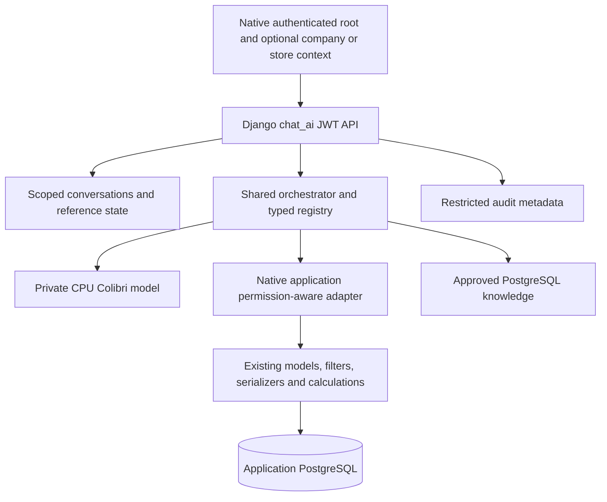

# Chat AI Assistant architecture

The initial Facturation integration has been extended through the authorized rollout to the six named applications. Business adapters remain inside each native backend; the reusable core, canonical MUI interface, synthetic datasets and training pipeline live in `chat_ai_assistant`. All adapters target one shared Colibri model. No replacement login or independent per-application model was introduced. Tested adapters and prepared datasets are not proof of model acceptance; see the application progress reports and [serial queue](AI_TRAINING_QUEUE.md).

## Request path

1. The dashboard root mounts one feature-flagged `ChatAIAssistant`. Existing NextAuth/Redux credentials authenticate requests through the application's JWT API.
2. Native application context determines the scope: an authorized company/store tab or picker where supported; otherwise an internal application partition with user-owned history. Réservation has no company picker. Browser context remains an untrusted hint.
3. Each native Django `chat_ai` adapter owns its conversations, references, permission checks and audits while reusing the central core. Memberships, roles, object restrictions and special native permissions are resolved by that application, including independent Hilton access in Réservation. Shared inference capacity also needs service-level concurrency limits; a per-app lease is not a global lease.
4. The core orchestrator offers only permitted tools, with a deterministic multilingual shortlist to reduce prompt size. Colibri returns one typed tool call or a bounded clarification reason. Free-form planner answers are rejected.
5. The executor validates the name and JSON arguments, rechecks permissions, calls a verified application adapter, bounds results and audits the operation. It never evaluates Python, shell, SQL or a model URL.
6. Structured business values go straight to typed cards. Financial calculations come from existing dashboard services. Reviewed bilingual knowledge answers stream verbatim; legacy documents without translations use a bounded second generation call. Source permissions and visible field labels are enforced during streaming.
7. JSON and SSE delivery revalidate conversation scope and referenced records. Stored history contains reference IDs/actions, not copies of business result payloads; reopening re-queries authorization.

## Boundaries and replaceability

- `src/chat_ai_assistant`: transport, contracts, orchestration, presentation guard, tool shortlisting and safe clarification text. It imports no Django application models.
- `facturation_backend/chat_ai`: actual business adapters and authorization. `catalog.py` handles article/payment/user reads; `documents.py` handles pro formas/credit/delivery notes; `operations.py` handles stock/logistics reads.
- `facturation_frontend/src/components/chat-ai`: persistent workspace, panel, shortcuts, typed cards, validated routes and streamed transport.
- `training`: immutable synthetic dataset versions, reproducible server-only LoRA scripts and evaluation records. No normal inference calls external AI services.
- `deploy`: private Colibri deployment with no public inference port; activation and evidence are tracked in AI_PHASE1_REPORT.md.

The backend vendors a wheel built from the central core using `scripts/package_core.py`; the manifest records source and wheel checksums. This avoids a production dependency on the developer's Desktop checkout. Rebuild the wheel after core changes.

## Facturation limits

Facturation writes cover bounded document/client metadata and confirmed deletion of supported documents/clients. Stock/logistics lifecycle changes, account administration writes, price changes and payment mutations are not exposed. The existing forms/services remain authoritative. Server training, inference measurements and production Linux image builds are complete. Broad model quality remains below target; see AI_PROGRESS.md and AI_PHASE1_REPORT.md for the actual deployment verification boundary.

Explicit general workflow/help questions route directly through the authorized knowledge tool and reviewed bilingual excerpts. Exact ordinal references route through the same authorized previous-results executor. Specific-record questions and business searches still use the local model; backend authorization and financial results never depend on generated prose. This reduces CPU work and prevents small-model generation failures from corrupting documented procedures or saved result identities.

## Other verified adapters

- `management_projet`: project-specific native permissions, business tools and knowledge; activation remains disabled pending shared-model acceptance.
- `design_workflow`: native project/task context and the visual reference for the canonical MUI component.
- `contrat`: native company/permission scope, contract/client tools, authorized PDF, confirmed bounded writes and shared UI. Source published disabled; see [Contracts progress](AI_CONTRACTS_PROGRESS.md).
- `gestion_magasin`: native store/role scope, catalogue/stock/sales/attendance tools, authorized wholesale PDF and confirmed bounded writes. Source published disabled; see [Gestion Magasin progress](AI_GESTION_MAGASIN_PROGRESS.md).
- `reservation`: native read/write flags, independent Hilton access, reservations/premises/rents and annual metrics. No company selector or generic PDF tool. See [Réservation progress](AI_RESERVATION_PROGRESS.md) for verified source/release status.

Each adapter invokes its existing services/serializers/views and scopes history and knowledge before results reach the model. Supported mutations differ by native application and require exact confirmation plus instructing-user history. They are not a promise that every native form action is exposed to the model.

`frontend/chat-ai` is the canonical MUI interface with local SVG icons. `scripts/sync_frontend.py` copies/checks its six files; app controllers retain native API/auth/router integration, company/store context and permitted suggestions/commands. No second design library is required.

Training remains serial and server-only. Prepared six-app curricula preserve earlier source rows and independent evaluation sets. Current V5 covers the original three apps; Contracts, Gestion Magasin and Réservation training remain separate later stages using the same shared model. No future-stage dataset is represented as already trained.
